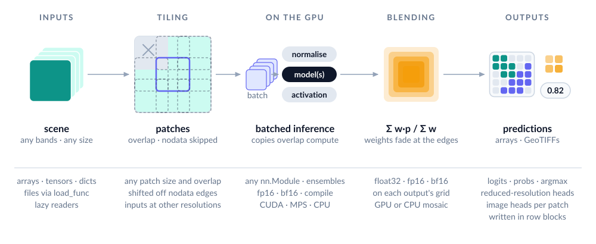

<p align="center">
  <picture>
    <source media="(prefers-color-scheme: dark)" srcset="https://raw.githubusercontent.com/DPIRD-DMA/ManyPred/main/docs/assets/logo-dark.svg">
    
  </picture>
</p>

<p align="center">
Tiled and batched inference for PyTorch dense-prediction models.<br>
Pass an array and get the prediction back, or pass a list of files and get predictions written.
</p>

<p align="center">
  <a href="https://pypi.org/project/manypred/"></a>
  <a href="https://pypi.org/project/manypred/"></a>
  <a href="https://github.com/DPIRD-DMA/ManyPred/actions/workflows/ci.yml"></a>
  <a href="https://manypred.readthedocs.io/en/stable/"></a>
  <a href="https://github.com/DPIRD-DMA/ManyPred/blob/main/LICENSE"></a>
</p>

<p align="center">
  <picture>
    <source media="(prefers-color-scheme: dark)" srcset="https://raw.githubusercontent.com/DPIRD-DMA/ManyPred/main/docs/assets/pipeline-dark.svg">
    
  </picture>
</p>

<!-- docs-start -->

> **Status: pre-alpha.** Until 1.0, a minor version may change the API; the
> [changelog](https://github.com/DPIRD-DMA/ManyPred/blob/main/CHANGELOG.md) lists every change.

ManyPred is the inference engine of [OmniCloudMask](https://github.com/DPIRD-DMA/OmniCloudMask) (OCM)
pulled out into its own library. It matches OCM's outputs (see "Parity with OmniCloudMask"
below) and adds dict inputs and outputs, reduced-resolution and image-level heads, and scenes
larger than memory, so it can run [ManySeg](https://github.com/DPIRD-DMA/ManySeg) models as
well as any other PyTorch model that returns a tensor or a dict of tensors.

## Install

```bash
pip install "manypred[geo]"
```

The core needs only numpy, torch and tqdm; `[geo]` adds rasterio for reading and writing
GeoTIFFs.

## Three ways in

```python
import numpy as np
from manypred import predict_array, predict_batch, predict_files

# one scene, tiled: (C, H, W) in; (C, H, W) out, here (1, H, W) because of argmax
classes = predict_array(model, scene, patch_size=512, overlap=128, batch_size=4,
                        normalize={"type": "zscore", "scope": "tile"},
                        activation="softmax", output="argmax")

# many chips, each predicted whole: (N, C, H, W) or any iterable in, (N, ...) out
preds = predict_batch(model, chips, batch_size=16)

# many files: load, predict and write, with loading and writing on background threads
paths = predict_files(model, scene_paths, load_func=load, output_dir="predictions",
                      patch_size=1000, overlap=300, output="argmax", nodata=0)
```

`device=None` (the default) uses CUDA, then MPS, then the CPU. `dtype` is `"float32"` by default.
`"float16"` and `"bfloat16"` are faster and use less GPU memory, but they round the model's weights
and outputs: see "How a scene is tiled" for what that costs.
`nn.Module` models are moved to that device and to `dtype` in place and set to eval mode (on MPS their
`Conv2d` layers are also swapped for a subclass that makes inputs contiguous); pass
`copy.deepcopy(model)` to keep the original for training. A model in training mode that a dtype would round gets a warning, as the rounding is permanent. Each patch or chip must be predicted
on its own: ManyPred batches them freely, and `compile=True` pads short batches to a fixed size.
`nodata` is None by default, so no value marks missing pixels (NaN and infinity always do). Pass
the value that does (`nodata=0` for most satellite scenes) to skip and mask them. The model sees missing
values as 0, with or without normalisation.

`model` is an `nn.Module`, a callable, or a list of them, returning a tensor or a dict of tensors. A list is an ensemble and ManyPred
averages the raw outputs. Every argument after the first two is keyword-only. Chips of
different sizes need `predict_batch(..., group_by_shape=True)`: they are batched by size and
come back in input order, as a list. The
[`examples/`](https://github.com/DPIRD-DMA/ManyPred/tree/main/examples) run in a few
seconds each on a CPU (the ManySeg one, which needs ManySeg, in about 15):
[arrays](https://github.com/DPIRD-DMA/ManyPred/blob/main/examples/01_arrays.py),
[files](https://github.com/DPIRD-DMA/ManyPred/blob/main/examples/02_files.py),
[two inputs and three heads](https://github.com/DPIRD-DMA/ManyPred/blob/main/examples/03_multi_head.py),
[a scene read lazily](https://github.com/DPIRD-DMA/ManyPred/blob/main/examples/04_large_scene.py),
[OmniCloudMask's settings](https://github.com/DPIRD-DMA/ManyPred/blob/main/examples/05_omnicloudmask_settings.py),
[a ManySeg model trained, saved and predicted](https://github.com/DPIRD-DMA/ManyPred/blob/main/examples/06_manyseg_train_save_predict.py) and
[block post-processing](https://github.com/DPIRD-DMA/ManyPred/blob/main/examples/07_blocks.py).

The [`notebooks/`](https://github.com/DPIRD-DMA/ManyPred/tree/main/notebooks) are longer
walkthroughs on real Sentinel-2 tiles, saved with their figures: OmniCloudMask over a whole tile,
a flood map from a model trained in the notebook, two input resolutions with three kinds of output,
and a tile to polygons block by block.

## How a scene is tiled

Patches of `patch_size` sit on a grid with stride `patch_size - overlap`. The last row and
column move back to the scene edge. ManyPred skips patches that are entirely nodata (pixels
equal to `nodata`, NaN or infinite in every band), and shifts patches with a nodata edge inward so they
see more valid data (`shift_patches=False` keeps the plain grid). Each patch's prediction is
weighted with a ramp that fades over the `overlap` pixels, summed, and divided by the summed
weights. Patches go through the model `batch_size` at a time: the default is 1, and
4 to 8 can be faster on a GPU when memory allows (see "Speed").

The sums are kept in float32. `mosaic_dtype="float16"` halves the mosaic (a 4-class Sentinel-2 tile
takes 1.2 GB instead of 2.4 GB), and it is separate from `dtype`. Classifiers lose little to 16 bits:
on three full Sentinel-2 tiles with OCM's models, float16 inference changed 207 to 727 classes per
million pixels, and a float16 mosaic 18 to 119 more. Outputs in large units lose far more. On values
around 1500, the result was off by 0.0002 in float32, by 0.5 with `dtype="float16"`, and by 2.5 with
`mosaic_dtype="float16"` as well. Float16 sums overflow past 65504, and then you get a warning.

The mosaic lives on the inference device unless, on CUDA, it wouldn't fit. With
`mosaic_device="auto"` (the default) ManyPred compares its size, plus what finishing needs (little
for `"argmax"`, which needs no blend weights and works in chunks of rows), with the GPU's free memory once the outputs are known, and blends on the CPU
(with a warning) when it would take more than 80%. Predictions then reach the CPU on
their own stream, so the GPU keeps working. `mosaic_device=None` always uses the inference device and
`mosaic_device="cpu"` always the CPU. Scenes read lazily and written by `predict_files` hold only
a band of rows, so they stay on the GPU.

`merge="cut"` replaces blending: each pixel takes the prediction of the patch whose weight is
largest there (its most central patch; the one placed first on equal weights), all channels
together, so nothing is averaged across patch edges. It suits outputs that are decoded into
vectors or instances afterwards, where two patches' slightly different edges would blur into a
double edge. In ManySeg's experiments it helped road junctions, made no difference to roof faces
with 512 px patches and 128 px overlap, and hasn't been compared on trained field or footprint
models. It is set per output like `output` (`merge={"extent": "cut"}`), takes the same
memory as blending and works on every path (reduced-resolution heads, nodata, float16 mosaics,
row-block writing). In a 16-bit mosaic the weights are compared in its dtype, so weights within
its precision count as ties and go to the earlier, almost equally central patch: on a
2900 x 3100 grid that changed no pixel in float16 at patch/overlap 1000/300, 1024/255 or
2048/1000, and 0.007%, 0.003% and 1.7% of pixels in bfloat16.

A patch larger than the scene shrinks to fit, with a warning. OCM also shrinks a patch larger
than half the scene to half the scene when over 30% of the scene's values are missing; ManyPred does that
only with `adapt_patch_size=True`, since it changes the model's context from scene to scene.

Batches flow through one pipeline in both modes. A background thread collates the next batch
into pinned memory in its own dtype (uint8, uint16, float16 and the rest; uint32 and uint64
travel as int64, uint64 past int64's range as float64, exact to 2**53; float64 on MPS and
other types as float32). Chips of several dtypes travel in one that holds them all, as numpy
promotes them (int32 with float32 as float64, as float32 on MPS), so a chip gives the same
result whatever it is batched with; int64 with uint64 travels as int64 while the values fit. The batch is
copied to the GPU on its own CUDA stream. Normalisation runs in float32 on the device.
Predictions come back on a second stream, so the GPU keeps working while the host stores
results. On Apple MPS, a lock serialises GPU work across threads, because MPS crashes
otherwise.

## Outputs

Each model output goes through these steps in order:

1. `activation` (`"softmax"`, `"sigmoid"`, a callable, `"none"` or None), applied per patch,
   before blending, so probabilities are averaged rather than logits. None uses the activation
   the model declares in its `tiling_spec()`, if any; `"none"` means no activation.
2. Blending, in tiled mode. Pixels no patch covered (all-nodata areas) are NaN in float outputs.
3. `output`. `"logits"` returns the values as they are. `"probs"` needs an activation; an output
   the model declares as `"none"`, such as a regression head, keeps its values.
   `"auto"` (the default) is `"probs"` for outputs with an activation, passed or declared in
   the model's `tiling_spec()` (a saved ManySeg model declares one), else `"logits"`. `"argmax"` gives uint8
   classes (int64 past 256 classes) of shape `(1, H, W)`. A callable receives the blended float32 array as
   `(1, C, H, W)` (or `(B, C, H, W)` in batch mode).
   With `"argmax"`, nodata pixels (and pixels no patch covered) are class 0, the same as a real
   class 0; with the default GeoTIFF writer and `mask_nodata=True` the mask band tells them apart.
4. Nodata masking, which marks pixels where every band of the input is `nodata`, NaN or
   infinite:
   NaN in float outputs, so a missing pixel holds the same value wherever the patches fell, and
   0 in class outputs. `mask_nodata=False` keeps what the model returned where a patch covered
   them.

`"argmax"` raises a `RuntimeError` if the model returned NaN at a pixel with data, since class 0
would hide the failure. NaN at nodata pixels is fine, and a float output keeps a NaN the model
returned, where you can see it.

Any patch or chip with data whose raw outputs hold infinity or NaN is counted, and you get one
warning at the end of the run, in every dtype. In float16 this is how an overflow shows up. The count
is per patch, so a model returning NaN only at nodata pixels of a patch with data also warns.

Activation and output can be set per output with a dict, such as
`activation={"seg": "softmax", "score": "sigmoid"}`.

Outputs are classified by their shape:

| model output per patch | result |
|---|---|
| `(B, C, H, W)` | blended mosaic `(C, H, W)` |
| `(B, C, ceil(H/f), ceil(W/f))`, e.g. a ManySeg head with `scale=1/4` | blended on its own `ceil(H/f) x ceil(W/f)` grid; `patch_size` and `overlap` must be divisible by f |
| `(B, C)` image-level head | batch mode: `(N, C)`. Tiled mode: a `TilePredictions` |
| dict of the above | a dict, each output handled on its own |

f comes from the output's size. A scale the model's `tiling_spec()` declares for an output
picks between sizes that fit several f, and an output whose size doesn't fit its declared
scale is refused, in both modes.

An image-level head can be multi-class or multi-label, so ManyPred makes you choose its
treatment: pass an activation, or `output="logits"` for raw values. `TilePredictions` holds
one vector per patch. `to_map(stride)` paints the vectors back onto the scene,
`reduce("mean")` averages that map over valid pixels, and `reduce("max", min_valid=0.5)`
takes the maximum over patches with at least that fraction of valid pixels. Per channel,
`"mean"` skips NaN pixels of the map (a patch's NaN covers its whole footprint, overlaps
included) and `"max"` skips NaN patches. There is no `"sum"`, because
overlapping patches would be counted twice.

In tiled mode an image-level head always gives per-patch values. A global
`output="argmax"` applies to the dense heads and warns for the image-level ones; set `output`
per head (`{"seg": "argmax", "score": "probs"}`) to silence it. Heads the model declares as
regression (`"kind": "regression"` in its `tiling_spec()`) also keep their values and warn, since
their channels aren't classes; asking for `"argmax"` by name still gives it.

An uncertainty head's mean and log-variance are blended as one output, so overlaps average the
log-variance in log space, not the variance.

Never blend derived outputs such as instance labels, peaks or counts. Compute them with
`postprocess`, which runs once on the finished result in tiled mode, per chip on a background
thread in batch mode, and before saving in files mode. Blending caveats worth knowing: a
per-instance-normalised distance map is only approximate across seams (use a generous overlap),
density totals must be summed after blending, never per patch, and averaging log-variances is
an approximation.

## Normalisation

Normalisation is plain data, so it can be stored with a model and reused in training. Give one
step, a list of steps applied in order, or `{input_name: steps}`:

```python
normalize = [{"type": "scale", "value": 10000},
             {"type": "zscore", "mean": [0.1, 0.2, 0.3], "std": [0.05, 0.05, 0.07]}]
```

| type | options |
|---|---|
| `none` | no options: `x` as it is (e.g. for one input of a per-input spec) |
| `scale` | `value`, scalar or per band: `x / value` |
| `zscore` | dataset `mean` and `std`, or `scope="tile"` (per patch or chip) or `"scene"` (whole scene, before tiling) |
| `minmax` | `min`, `max`, `clip=True` |
| `percentile` | `low=2`, `high=98`, `scope` (`"tile"`, the default, or `"scene"`), `clip=True` |
| `db` | `eps=1e-10`: `10 log10(max(x, eps))` |
| `clip` | `min`, `max` (scalar or per band, either optional) |
| callable | `f(x, valid) -> x` on a `(B, C, H, W)` float32 tensor |

Statistics ignore nodata, NaN and infinity, and those values are 0 afterwards, so they never reach the
model, with no steps too (`normalize=None` without a stored spec, `normalize=False` or
`{"type": "none"}`). A value that is missing in only some bands is 0 in those bands, and the
pixel stays valid. Vectors are the exception, below. `normalize_torch` and
`normalize_numpy` apply the same code outside the pipeline, for training, and
`manypred.normalize.validate_spec` checks a spec. Outside the pipeline there is no scene, so
`scope: "scene"` statistics are per image passed (per sample of a training batch), as
`"tile"` is.
With a lazy reader, `scope="scene"` statistics come from a regular sample of at most 4 million
pixels, so they can differ slightly from an array's, which use every pixel.

## Several inputs

Pass a dict. The first `(C, H, W)` raster or `(T, C, H, W)` time series is the primary input. It sets the patch grid and
the nodata mask.

* Other rasters may have another resolution. Their ratio to the primary (a whole number or
  1 / a whole number) comes from the shapes or from `scales={"s1": 0.5}`, and their window is
  the primary window times that ratio.
* Time series `(T, C, H, W)` are tiled in H and W only.
* Vectors `(D,)` are passed through untiled and unnormalised, NaN included. That covers metadata
  and the `<name>_mask` and `<name>_dates` of a time series. Integer vectors keep their dtype
  (uint16 arrives as int32). Float vectors are cast to the inference dtype (in float16, exact to
  only about 3 significant digits), with two exceptions that stay float32: `<name>_dates`,
  because 16-bit floats can't hold a day count, and vectors the model's `tiling_spec()` declares
  (`"kind": "vector"`), so 16-bit inference doesn't round metadata (bfloat16 makes a category
  id of 257 into 256). A model that takes either must cast them itself under a 16-bit dtype;
  ManySeg's do.

## ManySeg models

A model can describe itself with a `tiling_spec()` method, which ManyPred reads without
importing the model's library. It covers input kinds and ratios, output scopes, scales and
activations, the padding multiple, a fixed input size and a stored normalisation. ManyPred uses
it to fill in `scales`, plan windows for reduced-resolution heads, round and cap the patch size,
pick each output's activation and, when `normalize` is None, normalise (pass `normalize=False`
to skip its steps). ManySeg models implement it (`DenseModel.tiling_spec()`). Explicit arguments
always win. The format is versioned (`"version": 1`, the default), and a ManyPred too old for a
spec says so instead of misreading it; see `manypred.spec`.

A ManySeg model saved with `manyseg.save(model, path, normalize=..., activations=...)` keeps
its training normalisation and each head's activation next to the weights; after
`manyseg.load(path)` its `tiling_spec()` carries both, so `predict_array(model, scene)` needs
neither. Heads saved with softmax or sigmoid give probabilities by default (`output="logits"`
or `activation="none"` asks for raw values).
A spec may also name each output's classes (`"classes"`) and the input bands (`"bands"`). With the
default writer `predict_files` keeps them in its files: class names as band descriptions when there
is one band per class, as a `classes` tag on an `"argmax"` band, the input bands as an `input_bands`
tag, and both in the JSON. Outputs from `postprocess` or a callable `output` aren't labelled, as
their values may no longer be per class.

[This example](https://github.com/DPIRD-DMA/ManyPred/blob/main/examples/06_manyseg_train_save_predict.py)
trains, saves, loads and predicts.

**Quantised models.** A model from `manyseg.quantize.quantize_weights` runs like any other.
One saved from `quantize_pt2e` loads as a `QuantizedProgram`, a callable that declares what it
needs, and ManyPred follows it:

| Attribute | What ManyPred does |
|---|---|
| `device` | The default when you pass no `device=`. |
| `batch_size` | Used in place of `batch_size=`, with a warning if you asked for another. Short batches are padded. |
| `fixed_size` | Sets `patch_size`, with a warning if you asked for another. A non-square size can't be tiled, but `predict_batch` runs it. `adapt_patch_size=True` is refused. |

Any callable that isn't an `nn.Module` can declare these. Padding repeats a batch's last item
and drops the extra outputs, so a program with a fixed batch size must treat each item on its
own, as a saved ManySeg model in eval mode does. `compile=True` speeds a program up but
runs its int8 steps in float. For int8 kernels, set `torch._inductor.config.freezing = True`
before the call. That setting is global, and outputs change slightly.

## Scenes larger than memory

`load_func` may return a reader instead of an array: any object with `.shape` and
`.read((top, bottom, left, right))`. `manypred.geo.RasterioReader` wraps a raster file. With
`mode="batch"`, which predicts each chip whole, a reader is read whole. The default
writer takes the transform and CRS from the reader's `profile`, unless `load_func` returns its own
`meta`. A reader of your own needs a `profile`, or `(reader, profile)` from `load_func`, or the
outputs have no transform or CRS.
ManyPred then reads patches as it needs them and keeps the nodata map at 1 bit per pixel.
With the default GeoTIFF writer and no `postprocess`, `predict_files` writes each output in row
blocks as soon as no remaining patch can change them. Otherwise it holds the whole output in memory, and warns once. On a 4096-pixel-wide scene, peak memory went from 1.40 GB at
16.8 megapixels to 1.60 GB at 1.07 gigapixels, most of which is torch and CUDA. Callable outputs
then run per row block, so they must work pixel by pixel.

Post-processing that needs the whole scene, such as decoding vectors, works block by block on
the saved rasters with `postprocess_blocks(fields, fn, block=4096, halo=256, combine=None,
workers=0)`. `fields` maps names to arrays or raster paths (read one window at a time). The
cores of a fixed grid partition the scene, and `fn(window_fields, block, scene)` gets each
core grown by `halo` pixels (clipped to the scene) as `{name: (C, h, w)}` arrays, plus the
`Block` (`core`, `window`, `scene_edges`, `index`) and the `Scene` (size, transform, CRS).
Results come back in grid order, through `combine(results, scene)` if given; `workers` runs
blocks in processes.
`predict_files(..., block_postprocess=BlockPostprocess(fn, block=..., halo=..., combine=...,
workers=..., save=..., fields=...))` does the same while predicting, so one call writes, say,
vectors. A lazy scene written in row blocks holds a strip of block rows plus `2 * halo` rows per
field, and each strip's blocks run as soon as its rows are final; other scenes are stitched in
memory first. Either way, for outputs saved as float values, the results equal
`postprocess_blocks` over the saved rasters. `fn` sees
the stitched values (after `merge`, activation and nodata masking, before `"argmax"` or a callable
`output`, and before `postprocess`) of full-resolution outputs (`fields`; reduced-resolution
heads are still saved, but can't be fed to it). Each scene's `combine` result goes to
`save(result, item, scene)`, or to `post.results[index of the item]`; `predict_files` returns
what it always does, and the rasters are written as usual.
[This example](https://github.com/DPIRD-DMA/ManyPred/blob/main/examples/07_blocks.py) stitches
with `merge="cut"`, post-processes the GeoTIFF by block, then does both in one call.

## Files

`load_func(item)` returns an image, or `(image, meta)`. It runs on a background thread, one item
ahead (with `mode="batch"`, a batch's items in parallel threads), and must return CPU data. `save_func(prediction, meta, item, output_dir) -> path` runs on
another background thread; `max_saves_in_flight` bounds how many predictions wait for it. If it
accepts `valid=` it also receives the valid-pixel mask, with `grid=` the (H, W) the model
predicted on, and with `factors=` `{output: f}`, how many times coarser than that grid each
dense output is (None for image-level outputs), in both modes.

Inference overlaps loading and saving, but loads and saves take turns, across the process.
GDAL's block cache is shared by every open dataset, so a read on one thread can write out a
GeoTIFF that another thread is closing, which can crash or leave a bad mask
([OmniCloudMask#52](https://github.com/DPIRD-DMA/OmniCloudMask/issues/52)). `load_raster`,
`stack_rasters`, `RasterioReader` and `write_geotiff` take the same turns from any thread. Any other
GDAL use, such as in a `postprocess` or a block `fn`, isn't covered. A slow save holds up the next
load, and `load_func` and `save_func` can't call `predict_files` or save from inside a load.

If your `load_func` and `save_func` don't use GDAL, `io_lock=False` stops them waiting for each other,
so a slow upload doesn't leave the GPU idle. Keep the default if either calls rasterio directly. The
helpers above and the default writer take turns either way.

Class outputs are written with LZW, and float outputs with DEFLATE level 1 and the floating-point
predictor (as OmniCloudMask), about half the size of LZW on logits. Writes use one thread: with
GDAL's `NUM_THREADS`, a compression thread that runs out of memory can lose blocks with no error. Files
that might pass 4 GB are written as BigTIFF (`BIGTIFF="IF_SAFER"`; a `BIGTIFF` in the profile wins).
Outputs don't inherit the source's tiling, block size, interleave, photometric or compression
settings, so a JPEG-compressed RGB source still gives a valid prediction file.

`manypred.geo` (`[geo]`) has two loaders that return `(array, profile)`, a `load_func`'s
`(image, meta)`. `load_raster(path, bands=None, resolution=None)` reads chosen bands (1-based),
optionally resampled to `resolution` CRS units with the extent kept.
`stack_rasters(paths, resolution=None)` stacks files that cover one extent, such as one file
per band at 10, 20 and 60 m, at one resolution (default the finest). Options after the path
are keyword-only. `resampling=` takes a rasterio name:
`"bilinear"` (the default, as OmniCloudMask), `"average"` for coarser pixels or `"nearest"` for
classes. `grid="source"` returns the file's own profile instead of the resampled grid's, so
the default writer writes predictions back at the file's resolution (GDAL resizes them with
nearest neighbour; OmniCloudMask's `load_multiband` does this). Files to stack must share a CRS
and extent on north-up grids; they are resized, not reprojected. The profile keeps the source's
nodata value, but `predict_files` uses its own `nodata=` (default None), so pass the file's. If you
don't, it warns once per call that those pixels count as data; `nodata=float("nan")` silences that.
There are no sensor loaders; a Sentinel-2 L2A one is a glob and `stack_rasters` (L1C files lack
the `_10m` suffix):

```python
from pathlib import Path
from manypred.geo import stack_rasters

BANDS = {"B04": "10m", "B03": "10m", "B8A": "20m"}  # L2A: each band's finest file

def load_s2(safe):
    files = [next(safe.rglob(f"*_{band}_{res}.jp2")) for band, res in BANDS.items()]
    return stack_rasters(files, resolution=10)

predict_files(model, sorted(Path("scenes").glob("*.SAFE")), load_func=load_s2,
              output_dir="out", patch_size=1000, overlap=300, nodata=0)
```

The default `save_func` (`[geo]`) writes `<stem>_pred.tif` on the grid of the rasterio profile in
`meta`, with the nodata mask as the mask band when `mask_nodata=True` (the default). Dict outputs get one GeoTIFF per dense output plus
a `<stem>_pred.json` manifest that also holds image-level values. `predict_files` refuses to start
if two items would share an output path or an output is also an input. `overwrite=False` skips items
whose output already exists, before loading them; with a custom `save_func`, pass
`output_path=f(item, output_dir)` so ManyPred knows where that is. `mode="batch"` treats every
item as a chip, 8 at a time by default, as `predict_batch` does.

An error stops the run. Its traceback names the item if it came from loading, saving or a scene in
tiled mode, but not from a batch of chips in the model. Saves already queued get up to 60 seconds to
finish before the error is raised, with a warning if they don't, and Ctrl-C doesn't wait. A slow
save may then still be running, and could overwrite an immediate retry's output. After fixing or removing that item,
`overwrite=False` resumes, predicting whatever has no output yet.

## Speed

On one AMD MI250X GPU, a 10980 × 10980 scene with 1024 px patches and 256 px overlap (196
patches) takes 3.3 to 4.3 s with a 3.8 M-parameter model in fp16; ManyPred's own work (reading
patches, preparing them on the GPU, blending, masking) is 0.4–0.5 s of that, and the rest is the
model. Most of ManyPred's share is a fixed cost per batch, so `batch_size` 4 to 8 cuts that share when
memory allows; it doesn't always make the whole call faster, so time it on your own model. `scripts/bench_gpu.py` reproduces these numbers.

## Parity with OmniCloudMask

ManyPred is checked against golden outputs of OCM at commit `50b8f5f`, a fixed record rather than
a promise to follow later versions of OCM
([`scripts/make_goldens.py`](https://github.com/DPIRD-DMA/ManyPred/blob/main/scripts/make_goldens.py),
40 cases including OCM's released models). OCM's options map like this:

| OmniCloudMask | ManyPred |
|---|---|
| `no_data_value=0` (its default) | `nodata=0` (ManyPred's default is None) |
| `inference_dtype=torch.float16` | `dtype="float16", mosaic_dtype="float16"` |
| per-patch normalisation | `normalize={"type": "zscore", "scope": "tile"}` |
| patch shrinking over large nodata areas | `adapt_patch_size=True` |
| `export_confidence=False` | `output="argmax"` |
| `export_confidence=True, softmax_output=False` | `output="logits"` |
| `export_confidence=True, softmax_output=True` | a callable output: OCM applies the softmax after blending, adds 0.001 and clips to [0.001, 0.999] ([example](https://github.com/DPIRD-DMA/ManyPred/blob/main/examples/05_omnicloudmask_settings.py)) |

Batch mode matches OCM bitwise on the machine that made the goldens. Tiled mode matches within
1e-4, with classes equal except where the top two logits are within 1e-3, since OCM normalises
patches with numpy and ManyPred with torch. Deliberate differences:

* NaN nodata is detected in tiled mode. At that commit OCM's tiled path doesn't detect it, so
  it predicts all-NaN patches as zeros and doesn't shift patches off NaN edges
  ([OmniCloudMask#46](https://github.com/DPIRD-DMA/OmniCloudMask/issues/46), fixed in OCM 1.8.0).
* `output="probs"` averages probabilities, as described above.
* Infinite inputs are missing, as NaN is.
* Nodata pixels in float outputs are NaN. OCM gives 0 where a patch covered them and NaN
  elsewhere, so the value depends on the patch layout.
* `"argmax"` of a NaN the model returned is an error. OCM makes it class 0.
* Float16 mosaics floor the blend weights at float16's smallest normal value, 6.1e-5, which
  keeps scene corners accurate at large overlaps. OCM's weights go down to 1/overlap².
* OCM refuses scenes and patches under 32 pixels; ManyPred takes any size (only
  `adapt_patch_size=True` stops shrinking at 32 pixels, as OCM does).

## Development

```bash
uv sync --group test --group parity --extra geo   # parity: OCM at the pinned commit
                                                  # --group manyseg: ManySeg, from git
uv run --group docs sphinx-build -W docs docs/_build # the documentation
uv run pytest -n 4                                # fast tier (cuda and mps tests if available)
uv run pytest -n 4 -m "slow or network"           # OCM's real models, examples
uv run ruff check . && uv run ruff format --check .
```

`scripts/fuzz_manyseg.py` builds random ManySeg models, saves and loads them, and checks
ManyPred's results against calling the model directly; a few seeds run in the slow tier.
Marked tests also exist for `cuda` and `mps`, and they skip without the device. CI runs Linux
and builds the docs on every push to `main`; pull requests and a weekly run add macOS and Windows,
the oldest supported numpy, torch and rasterio, and (weekly) the slow tier. The logo and the diagram come from
`scripts/make_logo.py` and `scripts/make_diagram.py`.

## License

MIT.
